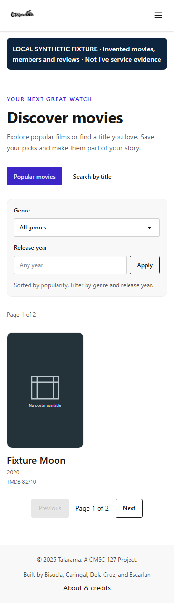
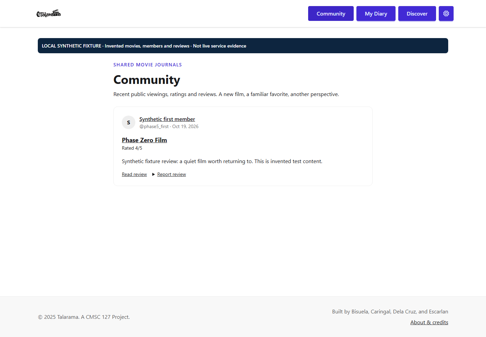

# Talarama

Discover movies, keep a private viewing diary and deliberately share reviews with a community. Google sign-in, favorites, watchlists, rewatches and personal ratings sit alongside TMDB discovery. There is no full-movie streaming.

**Status:** phases1–4 are implemented locally; phase5 adds local release readiness and portfolio evidence. No public deployment, hosted CI success or live-provider acceptance is claimed. A source license is still pending owner review; this is not yet an MIT/open-source release. See [release gates](docs/deployment.md#release-gates-still-requiring-acceptance).

## Portfolio preview

The images below show disposable **synthetic fixtures**, including invented movie/member/review data and missing-artwork fallbacks. They are not live TMDB results, real members or production activity. The capture-only banner is not part of the product. [Capture details and more views](docs/screenshots/README.md).





## What works locally

- Discover popular films by genre/year or search by title/year; share filters and distinct local/TMDB movie links. Reads do not import records. Explicit signed-in save/log actions import trusted metadata once.
- Keep favorites, watchlist and viewing history separate. Logs can be unrated, have no text and include rewatches/spoilers. Saving atomically removes that movie from your watchlist; deleting a log does not add it back.
- Entries and profiles begin private/unpublished. Public content requires a published profile, PUBLIC entry and VISIBLE moderation state. Favorites require a separate opt-in. Private dates, emails, account tokens and watchlists stay out of public responses.
- Browse chronological community activity, protected spoilers and shareable text reviews. Talarama `/5` counts one newest eligible rated viewing/member/movie; TMDB `/10` is separate. Reporting, audited moderation and shared PostgreSQL mutation quotas are implemented.

## Local setup

Use Node22 (22.14 or newer, below23), npm11 and PostgreSQL17. CI pins Node22.14.0/npm11.6.1; installed package versions/overrides are in [dependencies](docs/dependencies.md). Prisma CLI/client are both6.19.3.

1. Install dependencies with `npm ci` and generate the client with `npx prisma generate`.
2. Copy `.env.example` to ignored `.env`; replace placeholders with development settings. Never commit or share secrets. Prisma reads `.env`; Next additionally reads `.env.local`, so avoid conflicting overrides.
3. Create a dedicated **empty** development database and a separate disposable database ending `_test`. Set the URLs below. On the empty development DB only, run `npx prisma db push` without any data-loss flag to initialize the current schema. This bootstrap does not create migration history; see [migrations](docs/migrations.md). Existing/populated databases require backup/schema/history review first. Never use reset.
4. Configure genuine development OAuth/provider credentials for live discovery/sign-in, or use the isolated fixture tests below without them. `npm run check:env` lists missing names only; it does not verify connectivity/authentication.
5. Run `npm run dev`, then open [localhost:3000](http://localhost:3000). Without a TMDB token, saved local movies remain available and discovery shows an unavailable/retry state. A fresh install has no fake member reviews or automatic seed data.

For Google, create a development web client with origin `http://localhost:3000` and redirect `http://localhost:3000/api/auth/callback/google`. Set a unique random `NEXTAUTH_SECRET` (generate locally with `node -e "console.log(require('crypto').randomBytes(32).toString('base64url'))"`; never share output). Verify real sign-in, sign-out, sign-in again and preservation of an existing linked account's diary. Synthetic JWT tests do not establish OAuth acceptance. Read [TMDB authentication](https://developer.themoviedb.org/docs/authentication-application) to obtain a server-only API Read Access Token.

## Environment

| Name | Purpose |
| --- | --- |
| `DATABASE_URL` | Development Prisma connection; optional provider-compatible pooling. |
| `DIRECT_URL` | Direct non-pool connection to the same database/schema for schema operations. |
| `NEXTAUTH_URL` | Exact development origin; production/preview use separately reviewed HTTPS origins/callbacks. |
| `NEXTAUTH_SECRET` | Strong private environment-specific session secret. |
| `GOOGLE_CLIENT_ID`, `GOOGLE_CLIENT_SECRET` | Genuine development OAuth web client; absent credentials mean live sign-in is unverified. |
| `TMDB_READ_TOKEN` | Server-only bearer read token; never `NEXT_PUBLIC_`. Empty means live discovery is unavailable. |
| `TEST_DATABASE_URL` | Separate disposable PostgreSQL database ending `_test`; tests refuse to fall back to the development URL. |
| `PG_BIN` | Optional PostgreSQL17 binary directory for `pg_dump`/`psql`; Windows default is `C:/Program Files/PostgreSQL/17/bin`, other platforms use PATH. |
| `TALARAMA_DISABLE_COMPILER_CACHE` | Optional `1` for constrained disks; disables Next persistent compiler disk cache only. Browser config enables it. |

## Verification

```text
npm ci
npx prisma generate
npm run lint
npm run typecheck
npm test
npm run test:integration
npm run test:migrations
npx playwright install chromium
npm run test:e2e
npx prisma generate
npm run build
npm audit
npm audit --omit=dev
```

Integration/browser/migration commands require the disposable `_test` DB and matching PostgreSQL client tools. They create guarded generated schemas and remove only those schemas. Integration/browser setup creates ignored `.superpowers/` for local output. Historical tests replay actual old SQL before seeding legacy records, apply additive upgrades, compare IDs/accounts/relationships/exact timestamps and rehearse genuine pre/post `pg_dump` restoration. They do not reset member data.

Playwright starts/owns a loopback server on3100, uses synthetic persisted-session JWTs and preloads `tests/e2e/tmdb-fixture.cjs` only in that test process. It still exercises real provider validation/cache/import. Do not expose that server or carry its preload/secret into development or production. Wait for it to exit before generating Prisma/building on Windows; never force-delete a locked engine.

`npm run build` compiles the production application; DB-backed home fallback needs a configured reachable database. Use a separately initialized empty/disposable build DB in CI, not production. `.github/workflows/ci.yml` defines this sequence on Ubuntu with PostgreSQL17 and synthetic credentials, with no deployment/artifact-upload step. Only local equivalent results are recorded in [phase5 verification](docs/phase-5-verification.md); hosted execution has not been triggered. PostgreSQL17 image/client minor patches and runner packages follow their configured upstream repositories, so the workflow is repeatable rather than a bit-for-bit container snapshot.

## Engineering and operations

[Architecture](docs/architecture.md) explains local/external identity, cache boundaries, retry safety and public eligibility. [Diary operations](docs/diary-operations.md) covers saved-zone validation, UTC calendar dates, exact legacy timestamp preservation and uncertain-create recovery. [Catalog operations](docs/catalog-operations.md) covers preview-only matching, explicit reviewed apply and durable audit recovery. [Community operations](docs/community-operations.md) covers publication, handles, moderation and quotas.

Follow [migration safety](docs/migrations.md) before schema changes and [deployment/restore runbook](docs/deployment.md) before any future authorized hosting work. Fixture/empty-development preservation does not prove actual production preservation. Existing account links, local IDs and legacy values are retained; no ambiguous mapping/conversion is automatic. Member/review metadata deliberately remains generic/noindex.

[Contributing](CONTRIBUTING.md) describes local changes and checks. [Phase1](docs/phase-1-verification.md), [phase2](docs/phase-2-verification.md), [phase3](docs/phase-3-verification.md), [phase4](docs/phase-4-verification.md) and [phase5](docs/phase-5-verification.md) record measured evidence and known limits, including Next navigation response-stream cancellation. Passing journeys do not mean console-error-free operation.

## Credits and rights

Originally built by Bisuela, Caringal, Dela Cruz, and Escarlan as a CMSC127 project. The app's About & credits page attributes TMDB. [Provider attribution/terms and retention gates](docs/tmdb-attribution.md) are separate from [the inactive MIT proposal](docs/licensing-proposal.md). No source-code license grants movie artwork/data, trademarks or member-content rights. Real OAuth/TMDB, hosted CI, authorized staging migration/restore, hosting controls, rights/retention and public launch remain external acceptance gates.
